# Waylo

Waylo is a demo **HTTP → UDP gateway**. It offers REST endpoints (`POST /request/track`, `POST /request/quote`), translates
each request into a binary datagram, sends it over UDP to an external carrier gateway ("DHL") and
answers the HTTP request once the matching UDP answer comes back.

DHL does not exist, so the project ships a mock of it. The binary protocol (WPP v1) is invented
for the demo and specified in [Kaitai Struct](https://kaitai.io/):
[`waylo_message.ksy`](protocol/src/main/kaitai/waylo_message.ksy).

Kotlin 2.4 · Spring Boot 4.1 · Java 25 · Gradle 9.9 · OpenTelemetry javaagent 2.33 · Pyroscope OTel extension 2.1

## Architecture

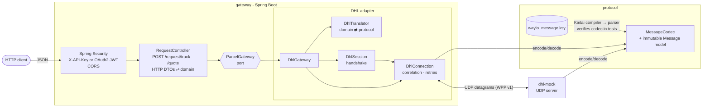

### Modules

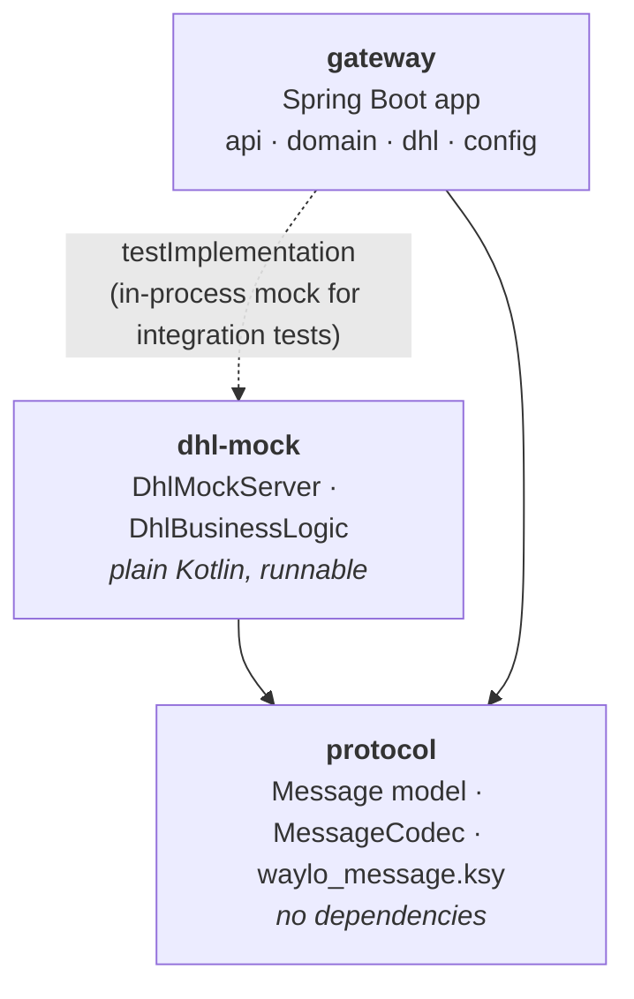

| Module                    | Package                      | Responsibility                                                        |
|---------------------------|------------------------------|-----------------------------------------------------------------------|
| [protocol](protocol)      | `dev.waylo.protocol`         | Immutable wire model, `MessageCodec` (never throws on decode), `.ksy` |
| [dhl-mock](dhl-mock)      | `dev.waylo.mock`             | Pretend DHL: sessions, fake parcel data, simulated loss and latency   |
| [gateway](gateway)        | `dev.waylo.gateway.api`      | `RequestController`, HTTP DTOs (JSON shapes) with domain mapping      |
|                           | `dev.waylo.gateway.domain`   | Domain data classes, `ParcelGateway` port                             |
|                           | `dev.waylo.gateway.dhl`      | UDP adapter: connection, session, translator                          |
|                           | `dev.waylo.gateway.config`   | Security (API key, OAuth2), CORS                                      |

### Data flow and clean separation

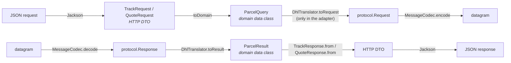

* **HTTP DTOs, then domain objects.** Jackson reads the body into a request DTO, which describes
  the JSON shape and maps itself to the domain (`toDomain()`); responses go the other way. Jackson's
  type conversion is the only check (required fields, numbers, strings to `Instant`); anything that
  does not fit is a 400. There are no further business
  rules in the gateway - DHL decides what it accepts.
* **Immutable.** Domain types and protocol messages are `data class`es with `val`s only.
  Protocol types enforce their wire limits on construction, so encoding cannot fail; a request
  value that does not fit the wire format (e.g. a dimension above 65535) is a 400.
* **Translate late.** Domain queries become protocol DTOs only inside the DHL adapter, right
  before they are encoded. Neither the controller nor the domain knows the protocol exists, so
  swapping the protocol later only touches `protocol` and `gateway.dhl`.

## The protocol (WPP v1)

Every datagram is one message: a 19-byte header, a body that depends on the message type, and a
CRC-32. Integers are big-endian, bit fields MSB-first.

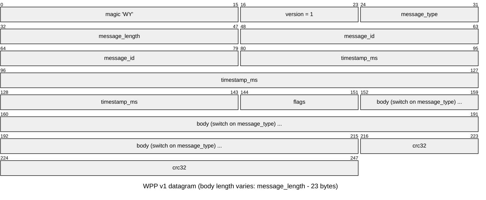

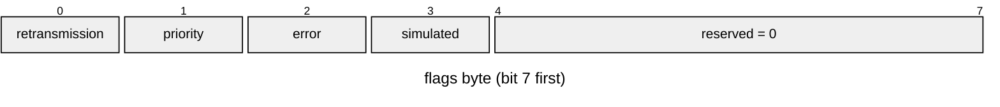

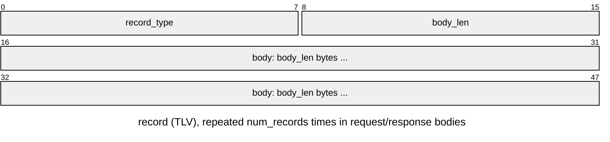

| Demo feature                       | Where in the protocol                                                  |
|------------------------------------|------------------------------------------------------------------------|
| Header switching on message type   | `message_type`: `handshake`, `handshake_ack`, `request`, `response`    |
| Length for validation              | `message_length` must equal the datagram size                          |
| Message id                         | `message_id`; answers carry `answer_for_id`                            |
| Timestamp                          | `timestamp_ms`, `tracking_event.timestamp_ms`                          |
| Bit flags                          | `flags`: retransmission · priority · error · simulated · 4 reserved    |
| Array of varying-length structures | `records`: type-length-value records, body switched on `record_type`   |
| Checksum                           | trailing CRC-32                                                        |

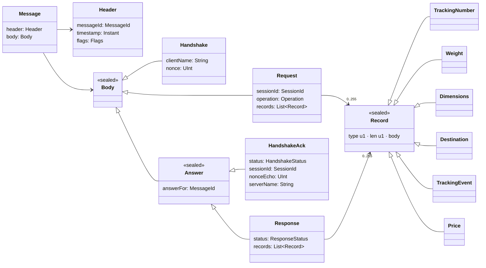

Operations: `track` sends `tracking_number` records and gets back `tracking_number, tracking_event*`
groups; `quote` sends `weight, dimensions, destination` and gets back one `price`.

### Handshake, correlation, retries

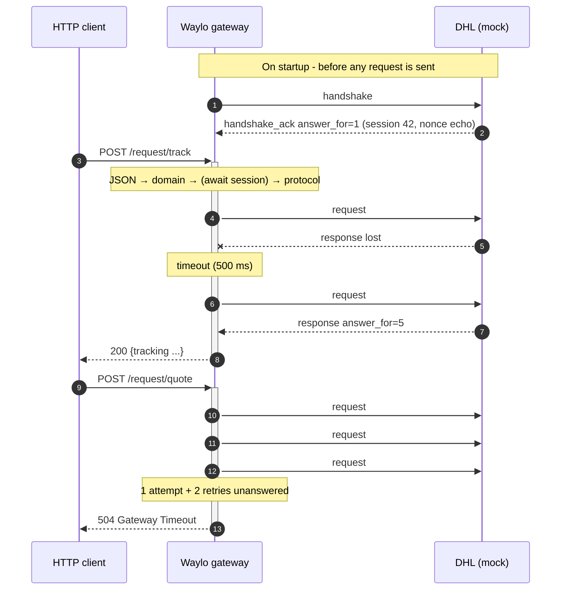

* Every outgoing message gets a fresh `message_id` and registers a pending exchange. One receiver
  thread completes the exchange whose id equals an answer's `answer_for_id` **and** whose expected
  answer type matches. Any number of exchanges can be in flight; late or duplicate answers are
  dropped.
* A retransmission resends the identical message (same id) with the `retransmission` flag.
* HTTP requests block (on virtual threads) until the session exists, at most
  `waylo.dhl.handshake.max-wait`, else `503`. The handshake is retried forever with a back-off.
* If DHL answers `invalid_session` (e.g. it restarted), the gateway handshakes again and retries
  the request once.

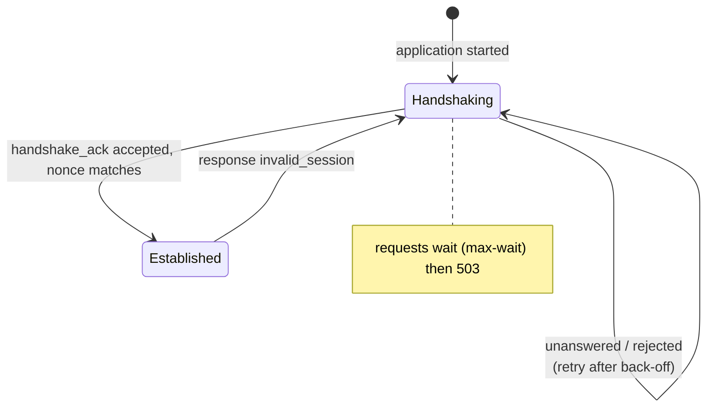

## HTTP API

One endpoint per query, `POST /request/track` and `POST /request/quote`, authenticated by **either** header:

| Client              | Header                          | Validation                                              |
|---------------------|---------------------------------|---------------------------------------------------------|
| machines            | `X-API-Key: <key>`              | constant-time match against `waylo.security.api-keys`   |
| frontend (Keycloak) | `Authorization: Bearer <JWT>`   | OAuth2 resource server: signature (realm JWKS), issuer, expiry, audience |

OAuth2 is active only when `spring.security.oauth2.resourceserver.jwt.*` is configured. The
frontend is a public Keycloak client (Authorization Code + PKCE); the gateway only validates tokens.
For browsers, CORS is configured with `waylo.cors.*` (Spring Boot has CORS properties only for
Actuator). The default allowed headers include `traceparent`, `tracestate` and `baggage`, so a
traced frontend continues its trace in the gateway (the OTel agent picks up W3C trace context).
Commented examples are in [`application.yml`](gateway/src/main/resources/application.yml).

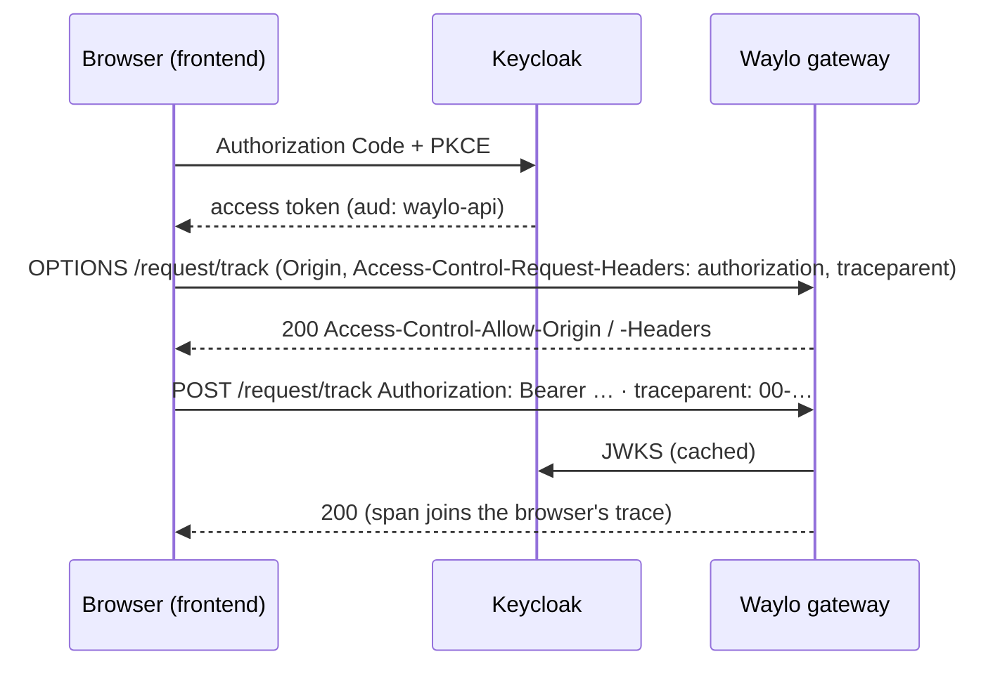


```bash
curl -X POST localhost:8080/request/track -H 'X-API-Key: local-dev-key' -H 'Content-Type: application/json' \
     -d '{"trackingNumbers":["JJD000390007"]}'
```
```json
{"parcels":[{"trackingNumber":"JJD000390007","status":"PICKED_UP","events":[
  {"timestamp":"2026-11-13T22:54:05.591Z","status":"LABEL_CREATED","location":"Nürnberg-Feucht"},
  {"timestamp":"2026-11-14T04:54:05.591Z","status":"PICKED_UP","location":"München-Aschheim"}]}]}
```

```bash
curl -X POST localhost:8080/request/quote -H 'X-API-Key: local-dev-key' -H 'Content-Type: application/json' \
     -d '{"priority":true,
          "parcel":{"weightGrams":1200,"dimensionsMm":{"length":300,"width":200,"height":100}},
          "destination":{"country":"DE","postalCode":"10115"}}'
```
```json
{"price":{"amountCents":739,"currency":"EUR"}}
```

The JSON shapes are the DTOs in [`HttpDtos.kt`](gateway/src/main/kotlin/dev/waylo/gateway/api/HttpDtos.kt).
Fields: `trackingNumbers` (list of strings), `parcel.weightGrams` and `parcel.dimensionsMm.*`
(integers), `destination.country` (ISO 3166-1 alpha-2) and `postalCode` (strings), optional
`priority` (sets the protocol `priority` flag; the mock then skips its latency).

Errors are [RFC 9457](https://www.rfc-editor.org/rfc/rfc9457) problem details:

| Status | When                                                                      |
|--------|---------------------------------------------------------------------------|
| 400    | JSON that does not fit the domain objects, values the protocol cannot carry, or DHL answered `bad_request` |
| 401    | no valid `X-API-Key` and no valid bearer token (`WWW-Authenticate: Bearer` when OAuth2 is on) |
| 502    | DHL answered `internal_error` or something that does not fit the request  |
| 503    | no DHL session yet (handshake pending), with `Retry-After`                |
| 504    | no answer after 1 + `retries` attempts                                    |

`GET /actuator/health` is public.

## Configuration

[`application.yml`](gateway/src/main/resources/application.yml):

| Property                             | Env               | Default               |
|--------------------------------------|-------------------|-----------------------|
| `waylo.security.api-keys`            | `WAYLO_API_KEYS`  | `local-dev-key`       |
| `spring.security.oauth2.resourceserver.jwt.issuer-uri` |  | unset (OAuth2 off)    |
| `spring.security.oauth2.resourceserver.jwt.audiences`  |  | unset                 |
| `waylo.cors.allowed-origins`         |                   | empty (CORS off)      |
| `waylo.cors.allowed-headers`         |                   | `Content-Type, Authorization, X-API-Key, traceparent, tracestate, baggage` |
| `waylo.dhl.host` / `port`            | `DHL_HOST` / `DHL_PORT` | `localhost` / `9999` |
| `waylo.dhl.timeout`                  |                   | `500ms` per attempt   |
| `waylo.dhl.retries`                  |                   | `2` (3 attempts)      |
| `waylo.dhl.handshake.retry-backoff`  |                   | `1s`                  |
| `waylo.dhl.handshake.max-wait`       |                   | `3s`                  |

DHL mock (environment): `DHL_MOCK_PORT` (9999), `DHL_MOCK_LOSS_RATE` (0, applied to requests and
answers independently), `DHL_MOCK_MIN_DELAY_MS` / `DHL_MOCK_MAX_DELAY_MS` (5 / 50).

## Run

```bash
docker compose up -d --build          # gateway on :8080 (override: WAYLO_PORT=18080), mock with 10% loss
```

or locally:

```bash
./gradlew :dhl-mock:run               # terminal 1
./gradlew :gateway:bootRun            # terminal 2
```

## Observability (OpenTelemetry + Pyroscope)

```bash
docker compose -f docker-compose.yml -f compose.observability.yml up -d --build
# Grafana: http://localhost:3000  ->  dashboard "Waylo — HTTP → UDP gateway"
# (WAYLO_PORT / GRAFANA_PORT override the published ports)
```

The gateway image carries two jars, attached only by [`compose.observability.yml`](compose.observability.yml)
via `JAVA_TOOL_OPTIONS`:

* the **OpenTelemetry Java agent** (zero-code: HTTP server spans, JVM/HTTP metrics, logs with
  `trace_id`, all pushed as OTLP), and
* the **Pyroscope OTel extension** (`-Dotel.javaagent.extensions`). It bundles the Pyroscope
  profiler (async-profiler), starts it (`OTEL_PYROSCOPE_START_PROFILING=true`) and labels profiles
  with the active span - no separate Pyroscope javaagent.

The Grafana stack is adapted from the `graf_zahl` showcase ([`observability/`](observability)):
Alloy is the single entry point and fans out to Tempo, Mimir, Loki and Pyroscope. k6 generates
steady demo traffic.

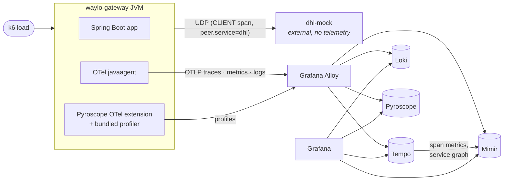

**DHL as a client dependency.** DHL is external and never participates in our telemetry, so it is
modelled like a database: every exchange is a `CLIENT` span `DHL <operation>`
([`DhlTelemetry`](gateway/src/main/kotlin/dev/waylo/gateway/dhl/DhlTelemetry.kt)) with
`peer.service=dhl`, `server.address/port`, `network.transport=udp`, `dhl.message.id`,
`dhl.attempts` and a `retransmission` event per retry. Timeouts set `error.type=timeout` and the
span status to error. Tempo's service graph therefore draws `waylo-gateway → dhl` as a virtual
node. The code uses only the OpenTelemetry API (a no-op without the agent).

Custom metrics: `dhl.client.exchange.duration` (histogram by operation and outcome),
`dhl.client.retransmissions`, `dhl.client.in_flight`, `dhl.client.dropped` (late, duplicate or
undecodable answers).

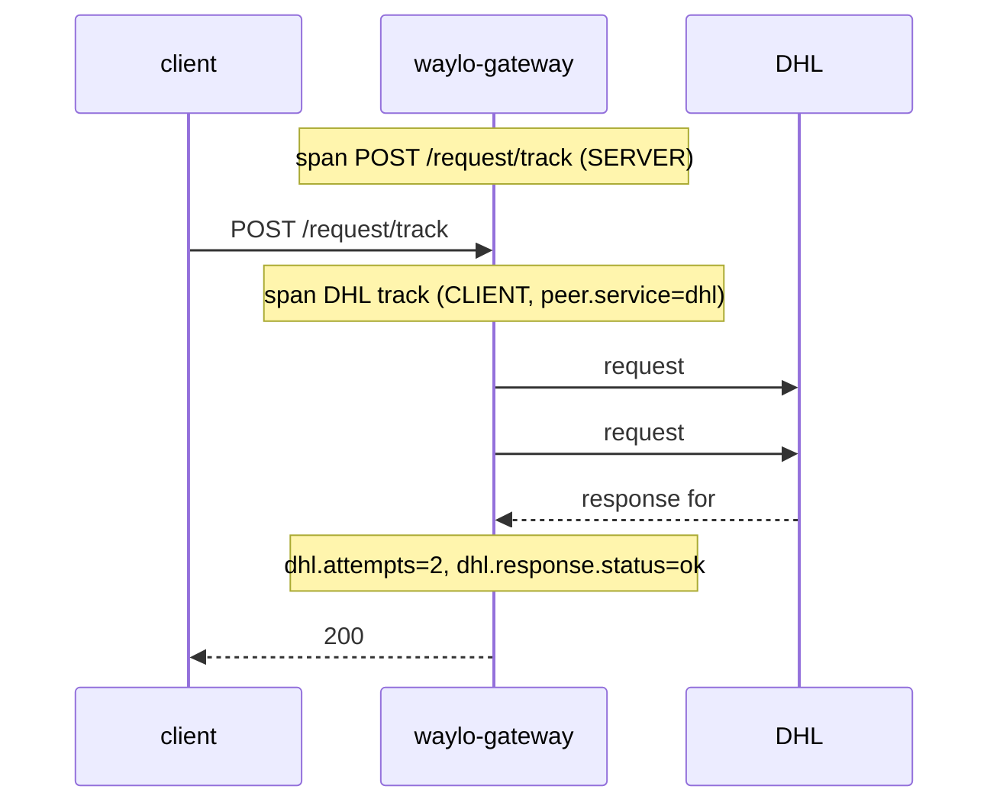

## Tests

```bash
./gradlew build
```

* **Kaitai conformance** ([`KaitaiConformanceTest`](protocol/src/test/kotlin/dev/waylo/protocol/KaitaiConformanceTest.kt)):
  the Gradle task `generateKaitaiParser` runs the Kaitai Struct compiler (from Maven Central) on
  the `.ksy` and compiles the generated Java parser into the test source set. Every sample and 500
  randomised messages are encoded by `MessageCodec`, parsed by the generated parser, mapped back
  to the model and compared; the CRC is recomputed. Corrupted datagrams must be rejected by both
  the `.ksy` validations and the codec.
* **Codec** round trips, header layout, and fuzzing (random/mutated datagrams never throw).
* **Gateway integration** against the in-process mock over real UDP: happy paths, 401, 400 for JSON
  that does not fit, 504 after exactly 3 datagrams with the same id and retransmission flags, 100 concurrent
  requests with out-of-order answers, session renewal; requests wait for the handshake.
* **Security**: real RS256 tokens against a local Keycloak stand-in (OIDC discovery + JWKS), so
  the production `issuer-uri` path is exercised; wrong audience, foreign issuer, expired and
  unsigned tokens are rejected; API keys keep working; CORS preflights with trace headers.
* **Telemetry**: the DHL CLIENT spans are checked with the OpenTelemetry SDK's in-memory exporter.
