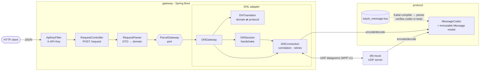
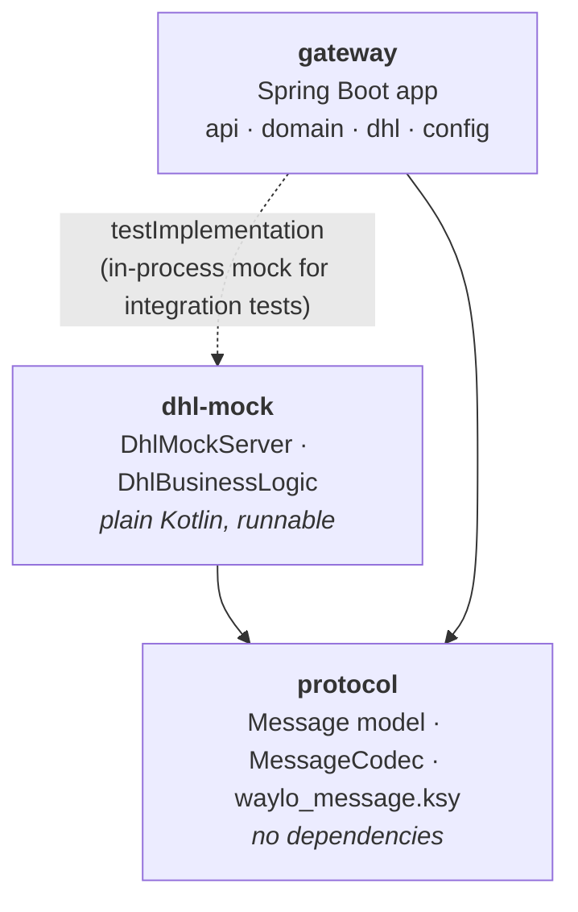
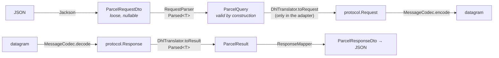
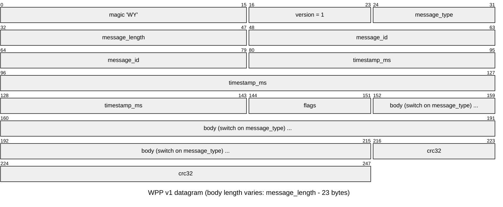
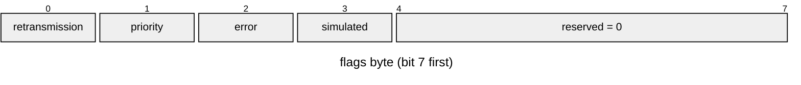
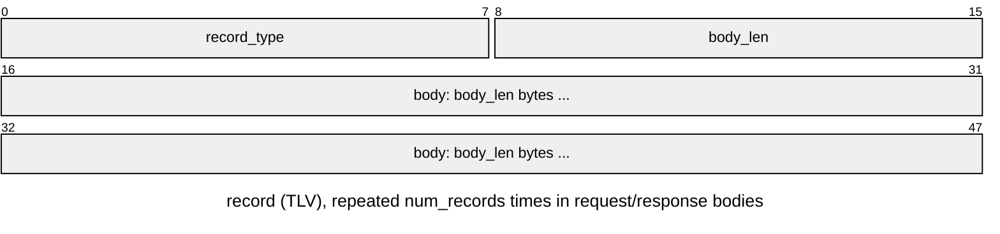
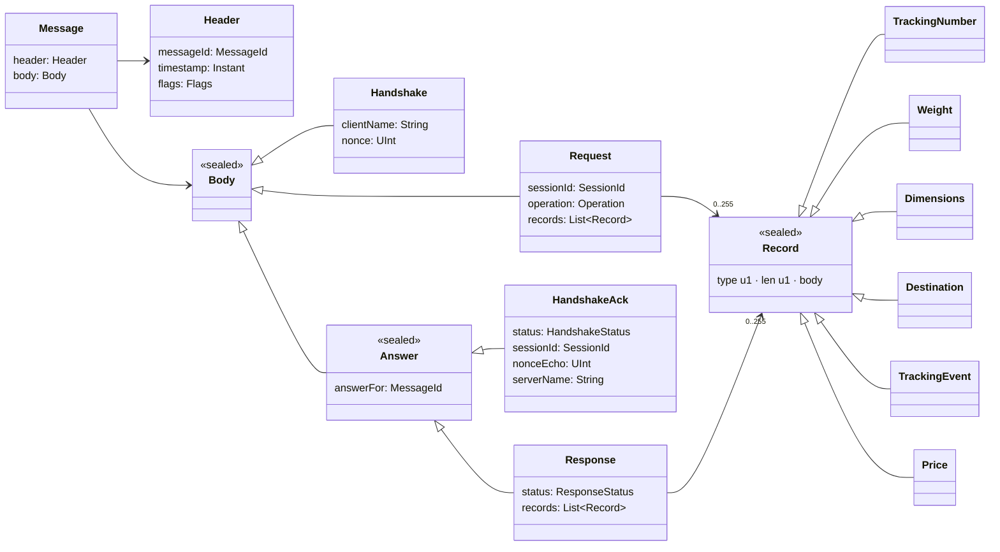
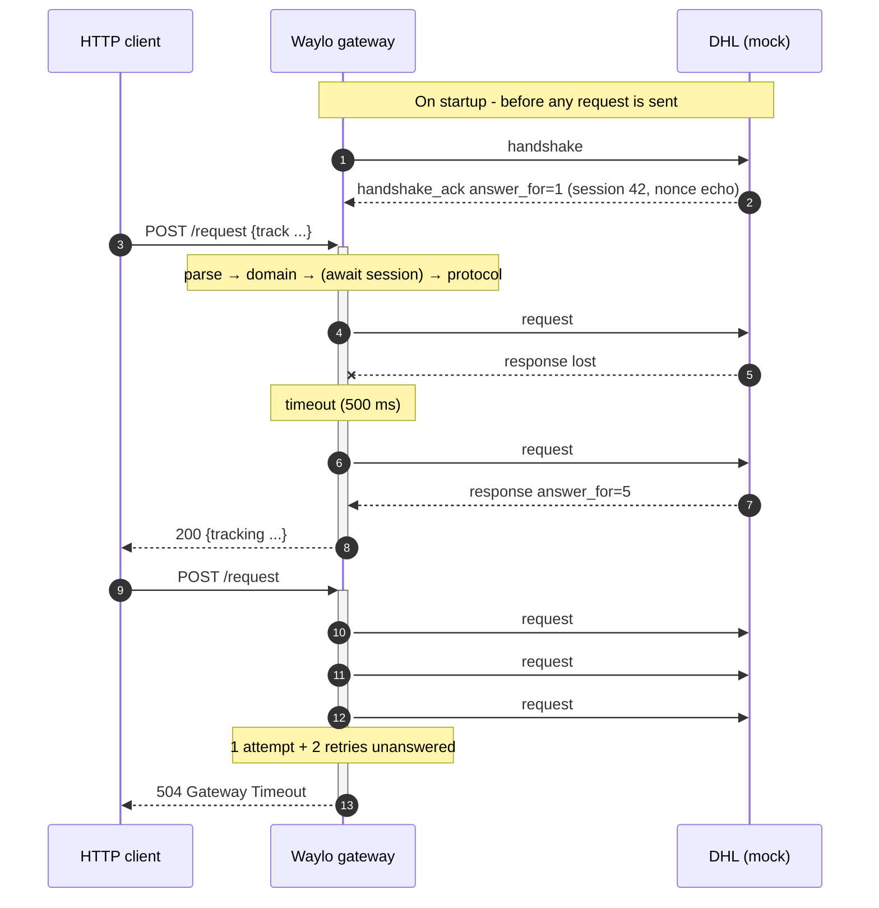
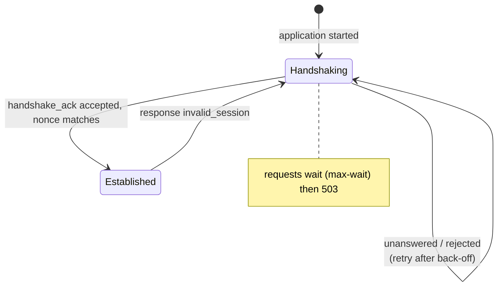

# Waylo

Waylo is a demo **HTTP → UDP gateway**. It offers a REST endpoint (`POST /request`), translates
each request into a binary datagram, sends it over UDP to an external carrier gateway ("DHL") and
answers the HTTP request once the matching UDP answer comes back.

DHL does not exist, so the project ships a mock of it. The binary protocol (WPP v1) is invented
for the demo and specified in [Kaitai Struct](https://kaitai.io/):
[`waylo_message.ksy`](protocol/src/main/kaitai/waylo_message.ksy).

Kotlin 2.4 · Spring Boot 4.1 · Java 25 · Gradle 9.9

## Architecture



### Modules



| Module                    | Package                      | Responsibility                                                        |
|---------------------------|------------------------------|-----------------------------------------------------------------------|
| [protocol](protocol)      | `dev.waylo.protocol`         | Immutable wire model, `MessageCodec` (never throws on decode), `.ksy` |
| [dhl-mock](dhl-mock)      | `dev.waylo.mock`             | Pretend DHL: sessions, fake parcel data, simulated loss and latency   |
| [gateway](gateway)        | `dev.waylo.gateway.api`      | HTTP DTOs, `RequestParser`, `ResponseMapper`, controller              |
|                           | `dev.waylo.gateway.domain`   | Immutable domain model, `Parsed<T>`, `ParcelGateway` port             |
|                           | `dev.waylo.gateway.dhl`      | UDP adapter: connection, session, translator                          |
|                           | `dev.waylo.gateway.config`   | API-key security                                                      |

### Data flow and clean separation



* **Parse, don't validate.** Incoming JSON is bound to loose DTOs and then *parsed* into domain
  types (`TrackingNumber`, `Weight`, `CountryCode`, ...) whose constructors are private. Holding a
  domain value proves it is valid. The parser collects *every* error, so a 400 lists them all.
  Answers from DHL are parsed the same way (`DhlTranslator.toResult`).
* **Immutable everywhere.** HTTP DTOs, domain types and protocol messages are `data class`es /
  value classes with `val`s only. Protocol types enforce their wire limits on construction, so
  encoding cannot fail.
* **Translate late.** Domain queries become protocol DTOs only inside the DHL adapter, right
  before they are encoded. Neither the controller nor the domain knows the protocol exists, so
  swapping the protocol later only touches `protocol` and `gateway.dhl`.

## The protocol (WPP v1)

Every datagram is one message: a 19-byte header, a body that depends on the message type, and a
CRC-32. Integers are big-endian, bit fields MSB-first.







| Demo feature                       | Where in the protocol                                                  |
|------------------------------------|------------------------------------------------------------------------|
| Header switching on message type   | `message_type`: `handshake`, `handshake_ack`, `request`, `response`    |
| Length for validation              | `message_length` must equal the datagram size                          |
| Message id                         | `message_id`; answers carry `answer_for_id`                            |
| Timestamp                          | `timestamp_ms`, `tracking_event.timestamp_ms`                          |
| Bit flags                          | `flags`: retransmission · priority · error · simulated · 4 reserved    |
| Array of varying-length structures | `records`: type-length-value records, body switched on `record_type`   |
| Checksum                           | trailing CRC-32                                                        |



Operations: `track` sends `tracking_number` records and gets back `tracking_number, tracking_event*`
groups; `quote` sends `weight, dimensions, destination` and gets back one `price`.

### Handshake, correlation, retries



* Every outgoing message gets a fresh `message_id` and registers a pending exchange. One receiver
  thread completes the exchange whose id equals an answer's `answer_for_id` **and** whose expected
  answer type matches. Any number of exchanges can be in flight; late or duplicate answers are
  dropped.
* A retransmission resends the identical message (same id) with the `retransmission` flag.
* HTTP requests block (on virtual threads) until the session exists, at most
  `waylo.dhl.handshake.max-wait`, else `503`. The handshake is retried forever with a back-off.
* If DHL answers `invalid_session` (e.g. it restarted), the gateway handshakes again and retries
  the request once.



## HTTP API

`POST /request` with header `X-API-Key`. The body's `type` selects the operation.

```bash
curl -X POST localhost:8080/request -H 'X-API-Key: local-dev-key' -H 'Content-Type: application/json' \
     -d '{"type":"track","trackingNumbers":["JJD000390007"]}'
```
```json
{"type":"tracking","parcels":[{"trackingNumber":"JJD000390007","status":"PICKED_UP","events":[
  {"timestamp":"2026-11-13T22:54:05.591Z","status":"LABEL_CREATED","location":"Nürnberg-Feucht"},
  {"timestamp":"2026-11-14T04:54:05.591Z","status":"PICKED_UP","location":"München-Aschheim"}]}]}
```

```bash
curl -X POST localhost:8080/request -H 'X-API-Key: local-dev-key' -H 'Content-Type: application/json' \
     -d '{"type":"quote","priority":true,
          "parcel":{"weightGrams":1200,"dimensionsMm":{"length":300,"width":200,"height":100}},
          "destination":{"country":"DE","postalCode":"10115"}}'
```
```json
{"type":"quote","price":{"amount":"7.39","minorUnits":739,"currency":"EUR"}}
```

| Field                         | Rule                                                      |
|-------------------------------|-----------------------------------------------------------|
| `trackingNumbers`             | 1-20 distinct, 8-35 letters/digits (normalised uppercase) |
| `parcel.weightGrams`          | 1..31500                                                  |
| `parcel.dimensionsMm.*`       | 1..1200                                                   |
| `destination.country`         | ISO 3166-1 alpha-2                                        |
| `destination.postalCode`      | 1-12 letters, digits, spaces, dashes                      |
| `priority` (optional)         | sets the protocol `priority` flag (the mock skips its latency) |

Errors are [RFC 9457](https://www.rfc-editor.org/rfc/rfc9457) problem details:

| Status | When                                                                      |
|--------|---------------------------------------------------------------------------|
| 400    | malformed JSON, unknown `type`, or parse errors (`errors: [{field, message}]`) |
| 401    | missing or unknown `X-API-Key`                                            |
| 502    | DHL answered with an error or an answer that does not fit the request     |
| 503    | no DHL session yet (handshake pending), with `Retry-After`                |
| 504    | no answer after 1 + `retries` attempts                                    |

`GET /actuator/health` is public.

## Configuration

[`application.yml`](gateway/src/main/resources/application.yml):

| Property                             | Env               | Default               |
|--------------------------------------|-------------------|-----------------------|
| `waylo.security.api-keys`            | `WAYLO_API_KEYS`  | `local-dev-key`       |
| `waylo.dhl.host` / `port`            | `DHL_HOST` / `DHL_PORT` | `localhost` / `9999` |
| `waylo.dhl.timeout`                  |                   | `500ms` per attempt   |
| `waylo.dhl.retries`                  |                   | `2` (3 attempts)      |
| `waylo.dhl.handshake.retry-backoff`  |                   | `1s`                  |
| `waylo.dhl.handshake.max-wait`       |                   | `3s`                  |

DHL mock (environment): `DHL_MOCK_PORT` (9999), `DHL_MOCK_LOSS_RATE` (0, applied to requests and
answers independently), `DHL_MOCK_MIN_DELAY_MS` / `DHL_MOCK_MAX_DELAY_MS` (5 / 50).

## Run

```bash
docker compose up -d --build          # gateway on :8080 (override: WAYLO_PORT=18080), mock with 10% loss
```

or locally:

```bash
./gradlew :dhl-mock:run               # terminal 1
./gradlew :gateway:bootRun            # terminal 2
```

## Tests

```bash
./gradlew build
```

* **Kaitai conformance** ([`KaitaiConformanceTest`](protocol/src/test/kotlin/dev/waylo/protocol/KaitaiConformanceTest.kt)):
  the Gradle task `generateKaitaiParser` runs the Kaitai Struct compiler (from Maven Central) on
  the `.ksy` and compiles the generated Java parser into the test source set. Every sample and 500
  randomised messages are encoded by `MessageCodec`, parsed by the generated parser, mapped back
  to the model and compared; the CRC is recomputed. Corrupted datagrams must be rejected by both
  the `.ksy` validations and the codec.
* **Codec** round trips, header layout, and fuzzing (random/mutated datagrams never throw).
* **Gateway integration** against the in-process mock over real UDP: happy paths, 401, 400 with all
  errors, 504 after exactly 3 datagrams with the same id and retransmission flags, 100 concurrent
  requests with out-of-order answers, session renewal; requests wait for the handshake.
